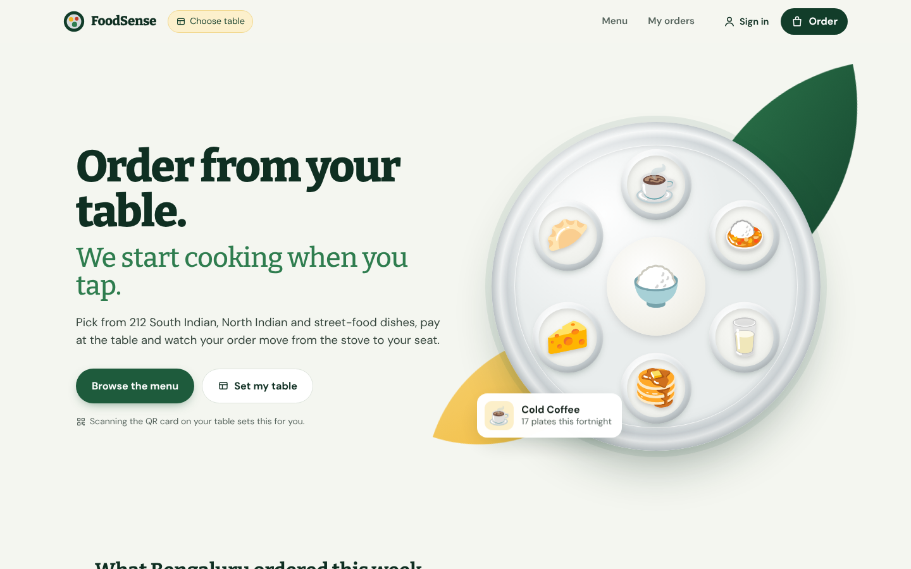
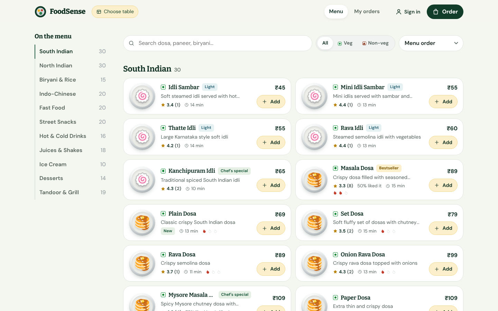
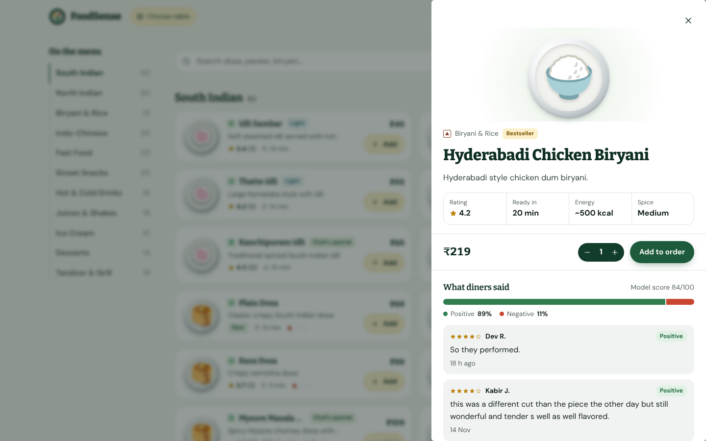
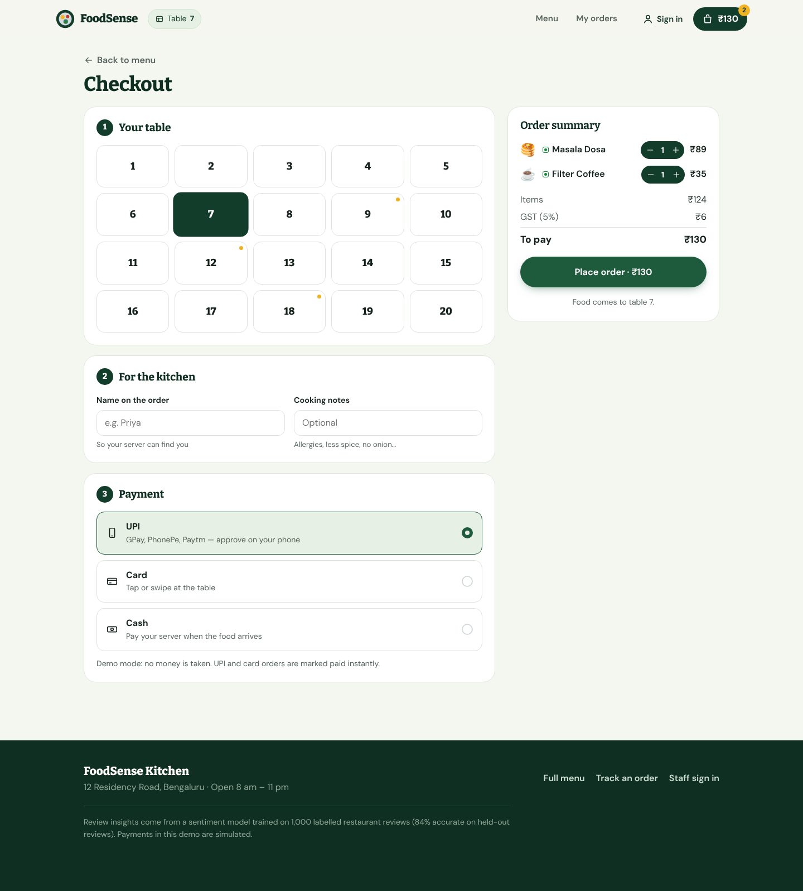
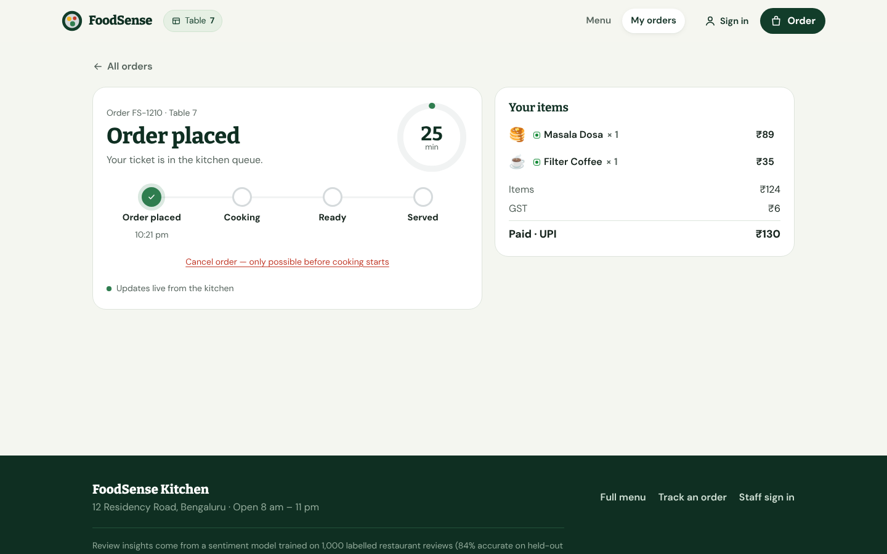
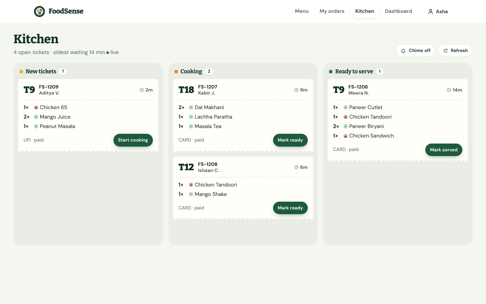
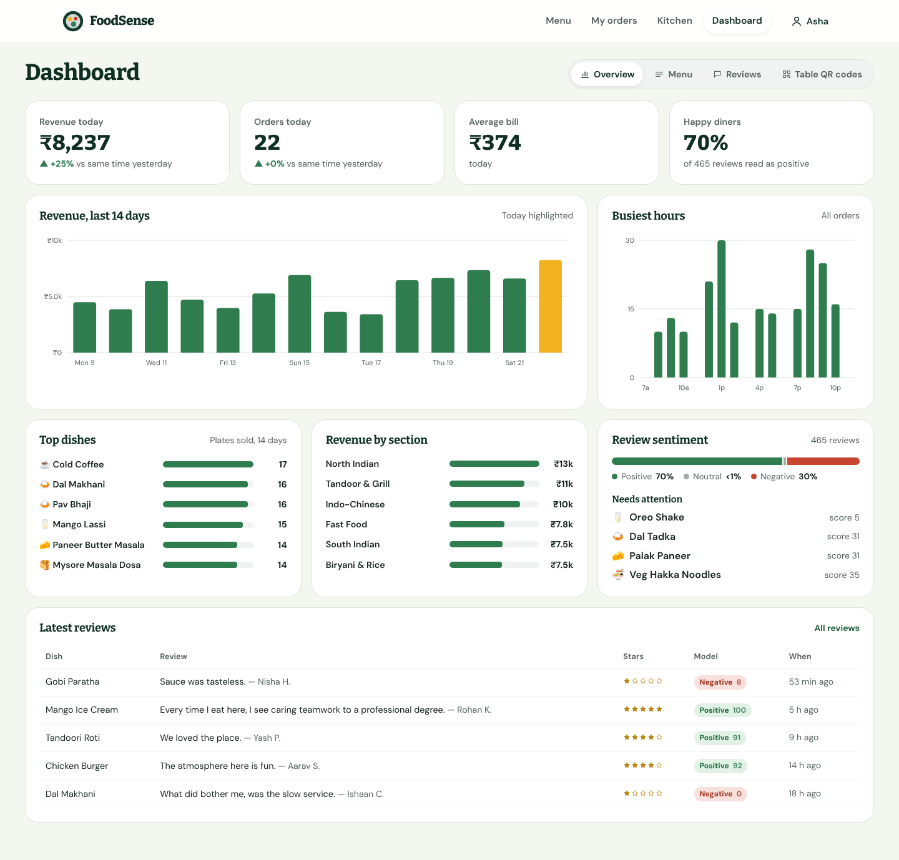
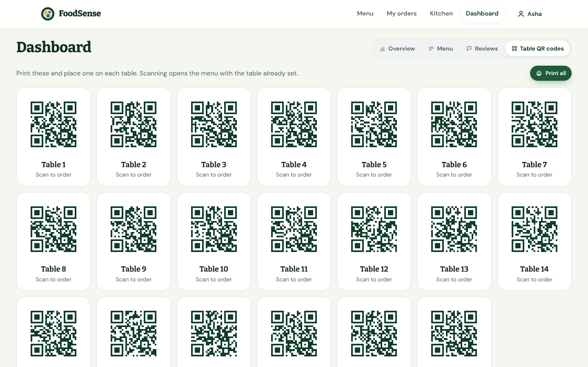
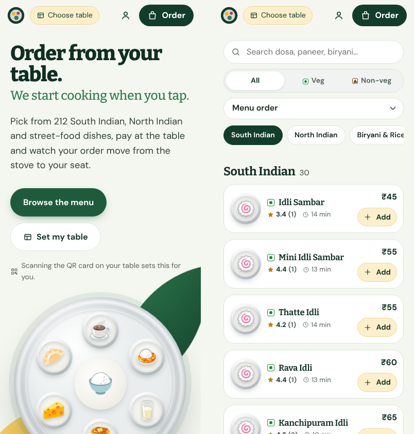

<div align="center">

# 🍛 FoodSense AI

**QR table ordering for restaurants, with a live kitchen board and AI review insights.**

Diners scan the card on their table, order and pay from their phone, and watch the food move from the stove to their seat.
The kitchen gets tickets the moment they're placed. The owner sees revenue, busy hours, and which dishes diners love or dislike,
scored by a sentiment model trained on real restaurant reviews.

[Demo video](#-demo) · [Features](#-features) · [Quick start](#-quick-start) · [Datasets & model](#-datasets--ai-model) · [API](docs/api.md) · [Architecture](docs/architecture.md)


</div>

---

## 🎬 Demo

**▶ [Watch the full demo (1 min 47 s, MP4)](docs/demo/foodsense-demo.mp4)**

The video walks through the whole flow:

1. **Landing page** with the animated thali and a live demo of the review-sentiment model
2. **Scanning a table QR** (`/t/12`), then searching and filtering the 212-dish menu
3. **Dish details** with ratings, model score, real diner reviews and "often ordered with" suggestions
4. **Cart → checkout → order placed**, with the server calculating the bill and GST
5. **Side by side:** the kitchen moves the ticket from *Cooking* to *Ready* to *Served* while the diner's tracking page updates live
6. **Rating a dish**, with the model reading the review as it's posted
7. **Admin dashboard**: revenue, busiest hours, top dishes, sentiment, menu control and printable table QR codes

The demo is recorded automatically by [`scripts/demo/record_demo.py`](scripts/demo/record_demo.py), so you can regenerate it after changing the UI.

## 📸 Screenshots

| Landing page | Menu |
|---|---|
|  |  |
| **Dish details & reviews** | **Checkout** |
|  |  |
| **Live order tracking** | **Kitchen board** |
|  |  |
| **Admin dashboard** | **Printable table QR codes** |
|  |  |

<p align="center"><br><em>Mobile-first: the diner side is designed for a phone at the table.</em></p>

## ✨ Features

### For diners
- **QR table check-in.** Each table's QR code opens `/t/<number>`, which sets the table automatically.
- **212-dish menu** in 11 sections, with a scroll-synced category rail, instant search, veg/non-veg filter (Indian FSSAI-style marks) and six sort orders.
- **Dish pages** show star rating, the model's score, positive/neutral/negative split, real reviews, prep time, calories, spice level, and dishes often ordered together (mined from order history).
- **Animated cart.** Dishes fly into the cart, the Add button turns into a quantity stepper, and the cart opens as a side sheet (bottom sheet on mobile).
- **Checkout** with a live seat map (busy tables are marked), kitchen notes, and UPI / card / cash. Payments are simulated.
- **Live tracking** over Server-Sent Events: a progress timeline, ETA ring and toast notifications. No refresh needed.
- **Rate each dish** after it's served. The review is scored by the sentiment model straight away.
- Guest ordering with no account needed. Signing in keeps your order history across devices.

### For the kitchen
- **Live ticket board** styled like kitchen order tickets (KOT) in three lanes: *New → Cooking → Ready to serve*
- New tickets drop in with an optional chime. Tickets running past their ETA turn red.
- One-tap status changes. The UI updates immediately and rolls back if the server rejects the change.

### For the owner (admin)
- **KPIs:** revenue today, orders, average bill and happy-diner %, each compared with the same time yesterday
- **Charts:** 14-day revenue, orders by hour, top dishes, revenue by section, review sentiment, and *needs attention* dishes (lowest model scores)
- **Menu control:** mark dishes sold out (diners see it live) and edit prices inline
- **Review feed** filterable by sentiment
- **Printable QR codes** for every table, from a QR encoder built into the app

### Quality
- **8 API tests** (`node --test`) covering auth, pricing, order lifecycle, permissions, sentiment and live events
- **Server-side pricing:** the client sends only dish IDs and quantities, so a modified client can't change the bill
- **Security:** scrypt password hashing, signed JWTs, role-based access, rate limiting, security headers and input validation
- **Accessibility:** keyboard focus styles, focus-trapped dialogs, ARIA roles on custom controls, `prefers-reduced-motion` support and a skip link
- Responsive from 360 px phones to wide desktops, with a print stylesheet for QR cards
- CI workflow, Dockerfile and Render blueprint included

## 🚀 Quick start

You need **Node.js 20 or newer**. MongoDB and Python are not required.

```bash
git clone https://github.com/nvaltryek-001/Food-Ordering.git
cd Food-Ordering
npm run setup     # installs the frontend (React + esbuild); the backend has no dependencies
npm run build     # builds the frontend into frontend/dist
npm start         # → http://localhost:5000
```

On first start the database is created and seeded automatically from the datasets.

| Try | URL |
|---|---|
| Diner flow (as table 12) | http://localhost:5000/t/12 |
| Kitchen board | http://localhost:5000/kitchen |
| Admin dashboard | http://localhost:5000/admin |

**Demo accounts** (also available as one-click buttons on the sign-in page):

| Role | Email | Password |
|---|---|---|
| Admin | `admin@foodsense.ai` | `admin123` |
| Kitchen | `kitchen@foodsense.ai` | `kitchen123` |
| Diner | `guest@foodsense.ai` | `guest123` |

### Development

```bash
npm run dev       # API on :5000 (auto-restart) + UI on :5173 (live reload, /api proxied)
npm test          # API test suite
npm run seed      # reset the database to a freshly seeded state
npm run data      # rebuild menu.json and retrain the sentiment model from the raw datasets
```

To change settings, copy `backend/.env.example` to `backend/.env`. All values are optional for local use. Set `JWT_SECRET` in production.

## 📊 Datasets & AI model

| Dataset | Used for | Size | Licence |
|---|---|---|---|
| **FoodSense menu** (`backend/data/raw/menu_items.json`), from this project's original menu seed | The menu | 214 rows → 212 dishes after de-duplication | Project data |
| **Restaurant Reviews** by [Aditya Mangla](https://github.com/aadimangla/Restaurant-Reviews-Sentiment-Analysis) (`backend/data/raw/restaurant_reviews.tsv`) | Training the sentiment model; seed reviews | 1,000 labelled reviews (500 positive, 500 negative) | MIT ([licence file](backend/data/raw/restaurant_reviews.LICENSE.txt)) |

**Menu enrichment** ([`build-menu.js`](backend/scripts/build-menu.js)) adds a veg flag, spice level, prep time, calorie estimate, artwork and tags (Bestseller, Chef's special, Light) to each dish.

**Sentiment model** ([`train-sentiment.js`](backend/scripts/train-sentiment.js)) is a multinomial Naive Bayes classifier using unigram and bigram features, with negation handling (*"not fresh"* is treated differently from *"fresh"*). It is evaluated on a stratified 80/20 split with a fixed seed, then retrained on all 1,000 reviews.

| Held-out metric (200 reviews) | Value |
|---|---|
| Accuracy | **84.0 %** |
| Precision | 79.8 % |
| Recall | 91.0 % |
| F1 | **0.85** |

Each review's label combines the model's probability with the star rating (70 / 30), giving *positive*, *neutral* or *negative* plus a 0–100 score. A dish's **model score** is the average score of its reviews.

> **About the demo data.** Seed reviews are real sentences from the dataset, assigned to dishes at random (reviews that mention foods not on this menu are filtered out). The 14 days of order history are simulated. Both exist so the dashboard has something to show on first launch.

The original **TensorFlow Lite RNN model** from this project is kept in [`ai/`](ai/README.md) as an optional service. Set `AI_SERVICE_URL` and the backend uses it, falling back to the built-in model if it's unavailable.

## 🏗️ Tech stack

| Layer | Technology |
|---|---|
| Frontend | React 19, a custom History-API router, hand-written SVG charts, CSS animations and the Web Animations API, esbuild |
| Backend | Node.js 20+ standard library only (`http`, `crypto`, `zlib`), with no npm dependencies |
| Realtime | Server-Sent Events |
| Storage | Embedded JSON document store with atomic writes |
| ML | Naive Bayes sentiment model trained in Node; optional TFLite RNN service (Python/FastAPI) |
| Typography | DM Sans + Bitter (self-hosted, SIL OFL) |
| Tooling | `node:test`, Playwright (demo recording), GitHub Actions, Docker |

```
Food-Ordering/
├── backend/
│   ├── src/                 app.js (routes) · services.js · sentiment.js · seed.js · db.js · events.js · lib/
│   ├── scripts/             build-menu.js · train-sentiment.js · seed.js
│   ├── data/                raw datasets · menu.json · sentiment-model.json
│   └── test/                API tests
├── frontend/
│   ├── src/                 pages/ · components/ · lib/ (api, router, store, qr) · styles.css
│   ├── public/              fonts, favicon, manifest
│   └── scripts/build.mjs    esbuild build + dev server
├── ai/                      optional TFLite review-model service
├── docs/                    api.md · architecture.md · demo/ · screenshots/
├── scripts/                 dev.mjs · demo/record_demo.py
├── Dockerfile · render.yaml · .github/workflows/ci.yml
```

More detail: **[docs/architecture.md](docs/architecture.md)** · **[docs/api.md](docs/api.md)**

## ☁️ Deploying

- **Docker:** `docker build -t foodsense . && docker run -p 5000:5000 -e JWT_SECRET=... -v foodsense-data:/app/backend/data/runtime foodsense`
- **Render:** connect the repo and it picks up `render.yaml`, which generates `JWT_SECRET` for you. Free instances have temporary disks, so orders reset on each redeploy. Add a persistent disk and set `DB_PATH` to keep them.
- **Any Node host:** `npm run setup && npm run build && npm start`

## ⚠️ Limitations

- Payments are simulated. No payment gateway is connected.
- The JSON store is built for a single restaurant and a single server process. For multiple branches or high traffic, replace `backend/src/db.js` with a real database.
- The sentiment model is trained on 1,000 general restaurant reviews, not reviews of Indian dishes specifically. Treat its scores as a signal, not a verdict.

## 📄 Licence

See [LICENSE](LICENSE). Third-party parts keep their own licences: the Restaurant Reviews dataset (MIT) and the DM Sans and Bitter fonts (SIL Open Font License, in `frontend/public/fonts/`).
